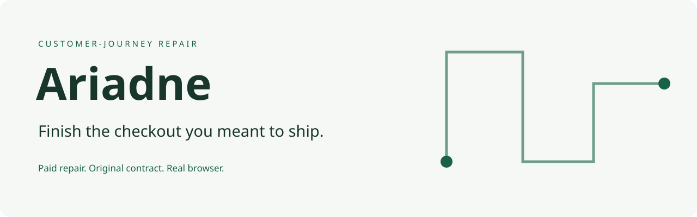
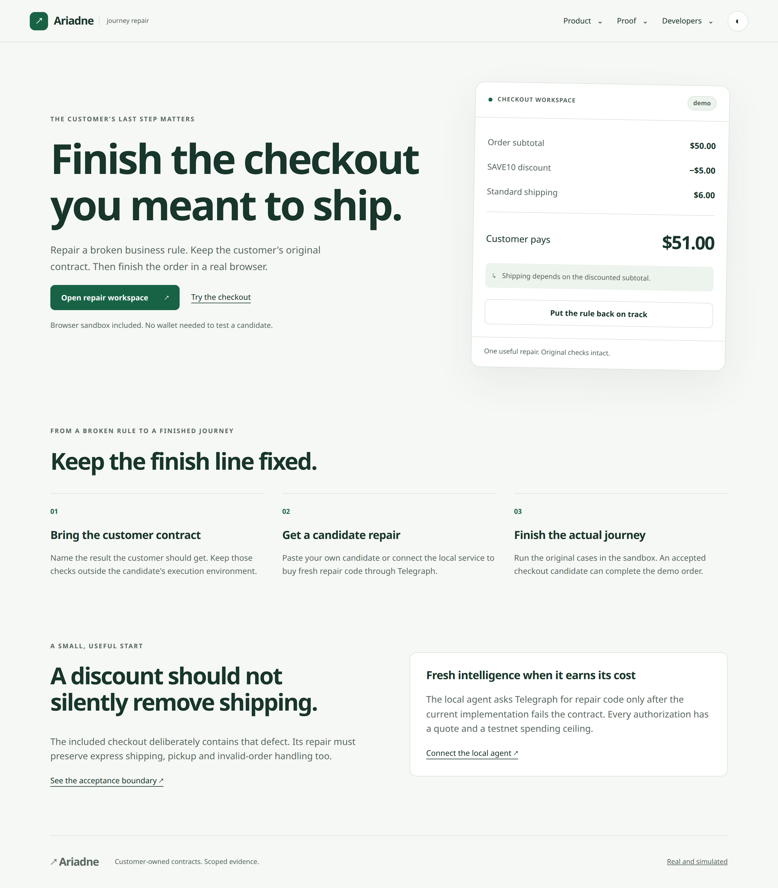
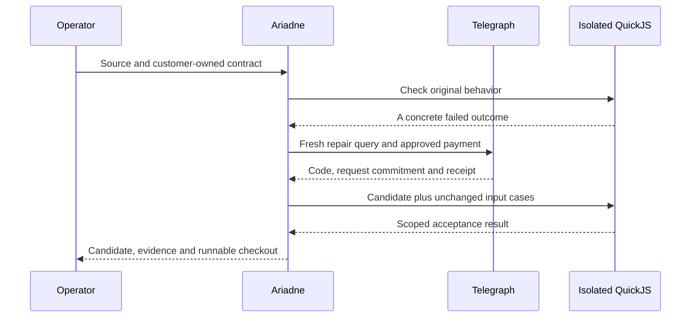
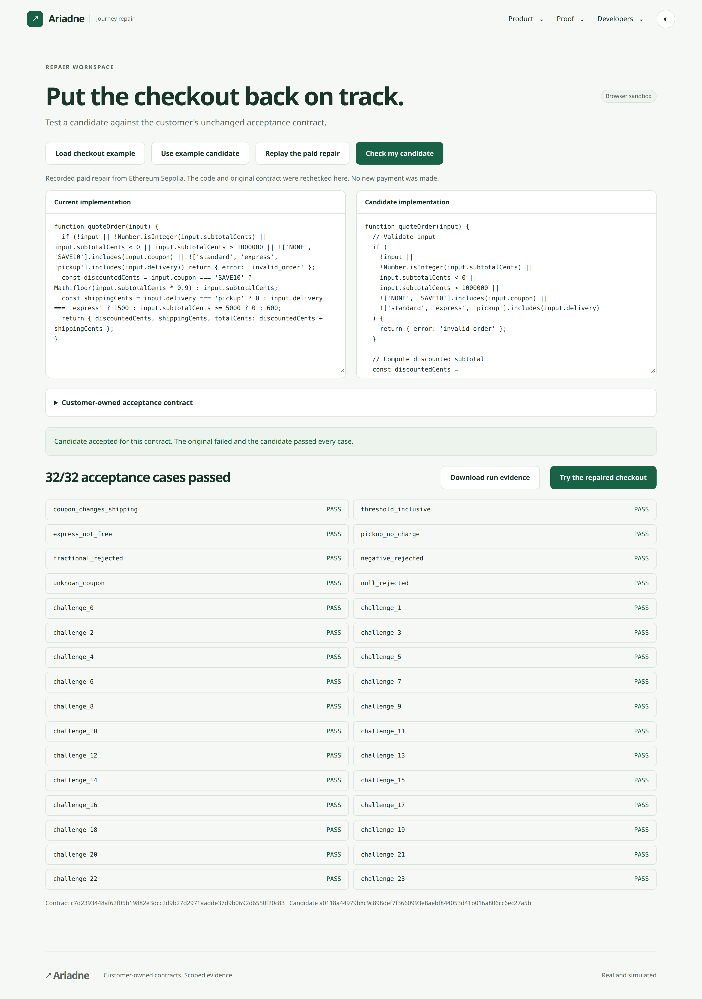
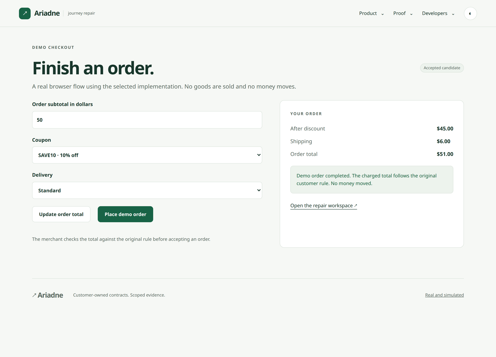
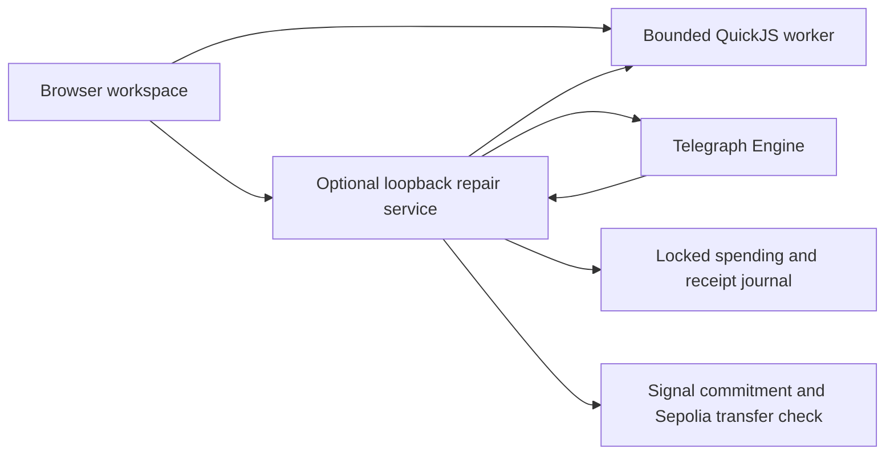

<!-- SPDX-License-Identifier: LicenseRef-zkasuran-SAND-1.0 -->
<picture><source media="(prefers-color-scheme: dark)" srcset="docs/assets/banner-dark.svg"></picture>

<p align="center"><a href="https://ariadne-journeys.pages.dev/"><b>Browser demo</b></a> · <a href="#try-it-in-60-seconds">Try it</a> · <a href="#how-it-works">How it works</a> · <a href="SECURITY.md">Security</a> · <a href="docs/REFERENCES.md">Sources</a></p>

<p align="center"></p>

**Ariadne repairs a business rule while keeping the customer's original contract intact.**
Its local agent buys fresh code through Telegraph after the original fails, checks the
receipt and executes the candidate in an isolated interpreter. The recorded repair
went from **30/32 to 32/32 acceptance cases for 0.01 test USDC**. A real browser then
completed the demo order.

Why now: a successful paid API reply does not establish that its code completes the
customer's task. Ariadne checks both the network evidence and the original outcome.

<picture><source media="(prefers-color-scheme: dark)" srcset="docs/assets/hero-dark.png"></picture>

## Try it in 60 seconds

Open the **[browser demo](https://ariadne-journeys.pages.dev/)**. It needs no wallet.

| Step | Action | Result |
|---|---|---|
| 1 | Open Demo checkout and place the default demo order | The original shipping rule cannot complete the order |
| 2 | Open Repair workspace and Replay the paid repair | The recorded request commitment and original contract are rechecked |
| 3 | Try the repaired checkout and place the demo order | The correct $51 total is accepted; no order payment moves |

Use **Check my candidate** for your own pure JavaScript function and JSON contract.
That is a genuine manual candidate test, separate from a Telegraph purchase.

## How it works



1. The host owns the expected results. Candidate code cannot change them.
2. The local service uses the documented free-form Engine path [ASK](docs/REFERENCES.md).
3. The paid answer is checked against its exact request, payer, signal and settlement [PAY](docs/REFERENCES.md).
4. Fresh sandbox contexts check the original contract. Acceptance is not a model's opinion.
5. The browser completes the controlled merchant flow using the accepted candidate.

| Repair workspace | Completed order |
|---|---|
|  |  |

## Evidence

| Recorded fact | Check |
|---|---|
| Provider | TxLens, selected through Telegraph's routed request |
| Charge | 0.01 Ethereum Sepolia test USDC |
| Acceptance | 30/32 before, 32/32 after on the original contract |
| Settlement | [Sepolia transaction](https://sepolia.etherscan.io/tx/0x201a66e92ca77623aa0fbb0d3a56603ca24a0423844c9d34889573f2bb4eb8fc) |
| Signal | [Exact request and raw answer](https://devnode.telegraphprotocol.com/engine/v1/signal/0x363d3baacadcda20adc8b5ee052bb71f2243a2e2269057386332b63521f7999c) |
| Public-safe record | [Paid proof](docs/evidence/paid-proof.json) |

The public demo rechecks that record. It does not buy code or claim a new settlement.
Receipt hashes identify calls; a transaction may settle more than one call.

## What is real and what is simulated

| Component | Status |
|---|---|
| Purchased candidate, receipt, signal and transfer | Real Ethereum Sepolia execution |
| Candidate sandbox and browser checks | Real execution |
| Example merchant and original defect | Controlled demo fixtures |
| Demo order | Simulated merchant transaction, no goods or money |
| Independent customer adoption | Not yet established |
| Production payments and repository-wide repair | Outside this release |

## Trust model

| Actor | Can access | Cannot access |
|---|---|---|
| Candidate | Its source and one input value | Host files, network, signer or expected outcomes |
| Telegraph provider | Repair query, source and failure summary | The local signer or host acceptance process |
| Local host | Contract, evidence and payment environment | No claim of trust against a malicious host |
| Public visitor | Browser sandbox and public-safe paid proof | A signing key or the private local service |

See [SECURITY.md](SECURITY.md) for the specific threat model and limitations.

## Architecture



## Run it locally

Node 22 or newer and Chrome for the browser gate.

```bash
git clone https://github.com/zkasuran/ariadne-journeys
cd ariadne-journeys
npm ci --ignore-scripts
npm run build
npm start
# http://127.0.0.1:4318
```

For a new paid repair, supply `HOUSE_WALLET_PRIVATE_KEY` in the environment at launch.
It is never written into this repository. Another operator can set
`ARIADNE_EXPECTED_PAYER` to their own address. Use only the supported Sepolia test token.
The source, specification and failed-case summary will be sent to the selected provider.

The local UI quotes the exact price and recipient before signing. The per-call ceiling
is 0.02 test USDC; daily authorizations stop at 0.05. A signed failure remains reserved
until the operator reconciles it. There is no automatic paid retry.

## Contract quickstart

```json
{
  "version": 1,
  "name": "Customer-owned increment",
  "entrypoint": "increment",
  "specification": "Return the numeric input plus one without changing any state.",
  "cases": [{"id": "first", "input": 4, "expected": 5}]
}
```

The candidate is a complete function, for example `function increment(value) { return value + 1; }`.
Imports and host callbacks are not provided. Source, data and execution have explicit ceilings.

## Built to be attacked

```bash
./verify.sh
```

CI runs that same gate: strict type checking, production build, 22 adversarial/protocol
tests, zero-vulnerability npm audit and four real browser walkthroughs in both themes.
The checks cover input mutation, state leakage, infinite computation, allocation,
quote changes, wrong receipts, concurrent spending and cross-origin access.

## What went wrong

The first live attempt returned 402 because the house wallet had no test USDC. It was
not counted as a successful purchase. After approved test-token setup, the provider
returned a valid repair but repeated the same code under answer and summary. The
strict extractor refused two blocks. It now permits identical duplicates and still
rejects different candidates. The captured purchase was recovered without paying again.

## Repository

```text
src/            contract, sandbox, payment, journal and local service
web/            shared product UI and browser worker
scripts/        build, browser gate and evidence recovery
test/           adversarial and protocol checks
docs/evidence/  public-safe recorded repair
docs/licenses/  retained third-party notices
```

## Roadmap

- [x] Pure business-rule candidate checking
- [x] Supported paid code generation with request-bound evidence
- [x] Recorded paid-code replay and browser order completion
- [ ] Independent developer reproduction and feedback
- [ ] External checkout integrations with explicit operator permissions
- [ ] Broader contracts with independently designed acceptance cases

## Assistance and licence

OpenCode with gpt-6.1-sol assisted implementation and verification. A Telegraph provider
generated the recorded candidate. Test and browser results above were run, not inferred.
No claim of human code review or independent adoption is made.

Own source: [Source-Available No-Derivatives](LICENSE), `LicenseRef-zkasuran-SAND-1.0`.
Third-party components keep their upstream terms in [NOTICE](NOTICE) and
[DATA-SOURCES.md](DATA-SOURCES.md). Users keep ownership of their own supplied source.
